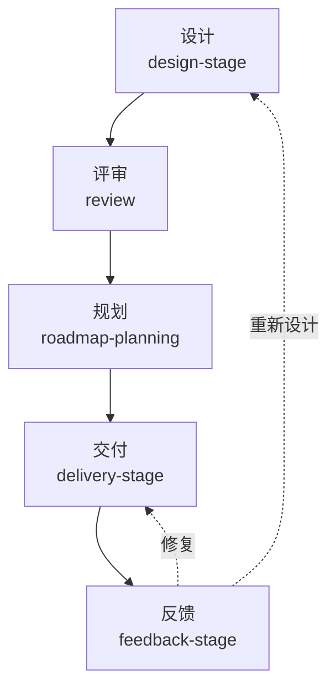

# Skills

个人 agent skills 仓库。每个 skill 是独立目录，含 `SKILL.md`（入口）及可选的引用文件（规范、模板等）。

## 先看这里

| 场景 | 入口 |
|---|---|
| 只读讨论、调研、方案比较 | 主工作区；不建 worktree |
| 要改代码/文档/配置/资源 | `worktree-workflow`：先建独立 worktree |
| 新功能/新模块/新系统设计 | `design-stage` |
| 设计已确认，准备实现 | `delivery-stage` |
| 测试/试玩/评审后要回流 | `feedback-stage` |
| 一次任务改多个仓库 | `multi-repo-commit` |
| 会话太长或要交接 | `session-handoff` |

## 主流程

| 阶段 | 什么时候进入 | 主流程 | 出口 |
|---|---|---|---|
| 设计 | 新功能、新模块、新系统、方案对比 | `design-stage`：选择输入 → 体验架构/职责设计/图设计 → 文档规则 → 评审 → 规划 | `review` → `roadmap-planning` |
| 交付 | 设计与规划已确认 | `delivery-stage`：入口确认 → `execution-loop` 连续执行 → `code-review` → `git-commit` → 验收状态 | `implementation-track` |
| 反馈 | 测试、试玩、评审、文档漂移 | `feedback-stage`：收集证据 → 分类 → 更新状态/文档 | `implementation-track` / `docs-audit` / `review` / `roadmap-planning`；回流设计或交付 |

- 设计阶段常用输入：`topic-research` / `code-digest` / `docs-audit` / `implementation-track`
- 设计阶段常用方法：`experience-architecture` / `responsibility-design` / 图设计 / `game-docs` / `docs-core`



> `docs-core` 是文档槽位基础；`skill-audit` 是 skill 仓库级审核，不进入项目交付流。

## 横切能力

| 能力 | Skill | 规则 |
|---|---|---|
| 会话边界 | `session-handoff` | 一个工作包一个会话；切换前写一页 handoff；状态先落盘 |
| 读写分流 | `worktree-workflow` | 只读讨论/调研留主工作区；写任务默认独立 worktree；主工作区只做集成/验证 |
| 多仓库提交 | `multi-repo-commit` | 每个仓库独立提交、推送、验证；没有跨仓库原子提交 |
| Skill 维护 | `skill-audit` | 抽象分层、触发边界、主动行为、术语与交叉引用 |

## Skill 索引

### 阶段 playbook

- **design-stage** — 设计阶段 playbook：输入选择 → 体验架构/职责设计/图设计（上下文/生命周期/时序）→ 文档规则 → 评审 → 规划；只写本阶段入口、检查与出口
- **delivery-stage** — 交付阶段 playbook：入口确认 → 工作包执行 → 代码审查与改动检查 → 提交 → 验收状态
- **feedback-stage** — 反馈阶段 playbook：证据收集与分类 → 状态/文档更新 → 评审/规划/设计回流

### 输入、文档与方法

- **topic-research** — 课题调研：生态全景、多入口交叉验证、证据分级，支撑外部结论写进文档
- **code-digest** — 代码库梳理：演进时间线 + 技术细节，防遗漏防过时、编号决策核对
- **docs-audit** — 文档集审核：交叉引用、术语一致性、翻译腔、版本锚点、图表覆盖、重复与数字核对；含实现后漂移扫描与 ID 覆盖矩阵
- **implementation-track** — 实现跟踪：验收项状态（◻/🔄/✅/❌）与偏差记录回写；含证据阶梯与最小 fake 接口
- **experience-architecture** — 产品体验架构：一页 Experience Map、屏幕/导航、状态所有权、生命周期、入口/退出与延后项；新增表面前的触发检查
- **responsibility-design** — 职责驱动设计：上下文地图、所有权、依赖方向、生命周期所有权、边界违规、组合根拆分与行为保持重构
- **docs-core** — 通用文档体系规则：7 类文档（入口/假设/规则/验收/决策/证据/检查，可裁剪）、单一事实源、行为变更三件套、ADR 实施/归档、状态语义（不绑领域）
- **game-docs** — 游戏文档体系（基于 docs-core）：Run Brief、Design Spec、验收矩阵、ADR、试玩；含跨项目设计模式参考

### 决策与规划

- **review** — 通用多角色评审：决策问题、角色意见、条件与行动项、证据、active/archive 索引；设计提案先缓冲
- **roadmap-planning** — 演进规划：把设计结论按依赖链归入 MVP/V1/V2（或 M0/M1/M2），定优先级与落点；含 M/W 两层映射

### 交付与提交

- **execution-loop** — 连续执行闭环：一次确认目标，批量执行、自测、提交、更新跟踪，只在真实阻塞时停
- **code-review** — 代码审查与合并前检查：必须修/建议修/可选分级、改动类型 → 必跑检查、测试质量、修复复跑；含游戏/软件/服务检查清单
- **git-commit** — Git 提交：分析变更、按 Conventional Commits 生成 message、执行提交
- **worktree-workflow** — 任务读写分流与 Git 工作树：只读讨论留主工作区，写任务默认独立 worktree + 短分支、合并顺序、冲突与清理；不替代 git-commit/code-review
- **multi-repo-commit** — 单会话多仓库提交：按仓库分组、分别提交推送、记录部分失败与跨仓库一致性；不替代 git-commit/worktree-workflow

### 会话与维护

- **session-handoff** — 会话边界与外部记忆：继续/新开判断、一页 handoff、记忆分层、并行/模型切换；不替代 execution-loop
- **skill-audit** — Skill 仓库审核：抽象分层、结构与触发边界、主动行为/干预策略、术语一致性、交叉引用与职责重叠

## 按问题找 skill

### 阶段、设计与规划

| 问题 | 用哪个 |
|---|---|
| 现在在设计、交付还是反馈 | **design-stage** / **delivery-stage** / **feedback-stage** |
| 新功能/新模块/新系统怎么设计、先定什么 | **design-stage** |
| 动态对象/生命周期怎么画图，类图或上下文地图够不够 | **design-stage**（图集）+ **responsibility-design**（边界） |
| 什么内容该写进哪篇文档 | **docs-core** |
| 给新游戏建一套设计文档 | **game-docs** |
| 当前里程碑做什么、行为规则、怎么验收 | **game-docs** |
| 产品有哪些屏幕、怎么导航、状态归谁管 | **experience-architecture** |
| 新增模式/设置/结算页，壳层要不要改 | **experience-architecture** |
| 模块职责怎么划、依赖怎么管、先修哪条 | **responsibility-design**（设计阶段或重构阶段） |
| 这个方案能不能过、附带什么条件 | **review** |
| 哪些进 MVP / V1 / V2，先做哪个 | **roadmap-planning** |

### 交付、提交与工作区

| 问题 | 用哪个 |
|---|---|
| 设计确认后怎么实现、审查、提交 | **delivery-stage** |
| 怎么连续做到底、别每步问 | **execution-loop** |
| 这次改动有没有问题、合并前该跑哪些检查 | **code-review** |
| 只读讨论/调研要不要开 worktree | 不开；留在主工作区 |
| 要改代码/文档/配置/资源，先做什么 | **worktree-workflow** |
| 讨论完了开始写，什么时候建 worktree | **worktree-workflow** |
| 多个会话同时改一个仓库怎么隔离 | **worktree-workflow** |
| 开 worktree/分支并行做两套方案 | **worktree-workflow** |
| 多个 worktree/分支怎么合并 | **worktree-workflow** |
| 一次任务改了多个仓库怎么提交 | **multi-repo-commit** |
| skills 和项目仓库都要提交 | **multi-repo-commit** |
| 不同域名/凭据的仓库一起推 | **multi-repo-commit** |
| 提交并推送 | **git-commit** |
| 这个会话太长了，要不要开新窗口 | **session-handoff** |
| 怎么把当前状态交接给新会话 | **session-handoff** |

### 文档、调研与维护

| 问题 | 用哪个 |
|---|---|
| 做完/试玩/测试后怎么回流到规划或设计 | **feedback-stage** |
| 验收失败/文档过时，下一步怎么处理 | **feedback-stage** |
| 文档集有没有矛盾、过时、重复 | **docs-audit** |
| 验收项做到哪了、偏差怎么记 | **implementation-track** |
| 代码现在是什么样 | **code-digest** |
| 外部生态 / 竞品 / 技术选型 | **topic-research** |
| 审 skills 仓库的抽象分层/术语 | **skill-audit** |

## 共用约定

### 流程约定

| 约定 | 规则 |
|---|---|
| 阶段 playbook | `design-stage` / `delivery-stage` / `feedback-stage` 只写本阶段入口、检查、出口与交接；生命周期图只在 README 维护 |
| 会话边界 | 一个工作包一个会话；切换前写一页 handoff；状态先落盘，临时推理不落盘 |
| 读写分流 | 只读讨论/调研留主工作区；写代码/文档/配置/资源默认独立 worktree；主工作区只做集成/验证 |
| 并行写 | 一个 worktree 一个写者；合并的是分支不是目录；共享接口/配置指定 owner |
| 多仓库提交 | 每个仓库独立提交/推送/验证；没有跨仓库原子提交；部分失败分别记录 |
| 交互边界 | 设计 / 方案 / 范围 / 取舍：先问用户；执行 / 提交 / 推送：直接做到目标，只在真实阻塞时停 |
| 不可逆操作 | force push、删分支/数据、部署、密钥操作：必须先问用户 |

### 文档与术语

| 约定 | 规则 |
|---|---|
| 文档类型 | `game-docs` 00~05、07 用 **game**（06 可选）；PRD + 各包 DESIGN.md 用 **software**；评审用 `review/profiles/` 下对应文件 |
| 单一事实源 | 行为在 Spec，验收在 Acceptance，证据在 Review（试玩结论可并入）；规划只排期，跟踪只更新状态 |
| 状态标记 | `◻ 未开始 / 🔄 进行中 / ✅ 通过 / ❌ 失败` |
| 验收 ID | `AC-<类别>-<序号>`；跟踪 skill 直接引用，不另起编号 |
| P0 / P1 | 只表示**验收优先级**：P0 必须通过，P1 可后置 |
| 代码问题级别 | `必须修 / 建议修 / 可选`，不要用 P0/P1 表示代码问题 |
| 功能 / 包优先级 | `High / Medium / Low`，不要写成 P0/P1 |
| 术语 | 统一用「规则 / 合并前检查 / 必须修 / 基准值」；词表与废弃词扫描见 `skill-audit/references/terminology.md` |
| 体验架构 | 一页 Experience Map；产品状态与局内/会话状态分离；延后项必须有触发器 |
| 图设计 | 静态结构用上下文/类图；动态行为用状态图/时序图；类图不能证明生命周期接线；高风险变更补所有权/事件表 |

## 安装

把 skill 目录复制到对应位置，支持 `.agents/skills` 的 agent 会自动发现：

**全局（所有项目可用）**

```sh
mkdir -p ~/.agents/skills
cp -r docs-core game-docs ~/.agents/skills/
```

**项目级（随仓库共享给协作者）**

```sh
mkdir -p <project>/.agents/skills
cp -r docs-core game-docs <project>/.agents/skills/
```

> `game-docs` 依赖 `docs-core`，需一并安装：两个目录都要在 `.agents/skills/` 下。其他 skill 可单独安装。

阶段 playbook、会话边界、工作树读写分流、连续执行与边界设计可按需安装：

```sh
cp -r design-stage delivery-stage feedback-stage session-handoff worktree-workflow multi-repo-commit execution-loop responsibility-design experience-architecture code-review ~/.agents/skills/
```

更新：重新执行复制命令覆盖即可；卸载：删除对应目录。

> `game-docs` 的脚手架 / 检查脚本是 Windows PowerShell；非 Windows 可手动复制 `references/templates/`，或使用 PowerShell 7。

装完在新会话中按 skill 的触发场景试探一句，确认能被自动加载。

## 新增/维护 skill

- 先过 `skill-audit`：通用规则放 `SKILL.md`，个人/团队偏好（风格、术语、环境约定）放引用文件，项目细节标注为示例；这样其他团队/项目只需整体替换 `standards.md`。判据、扫描种子与检查清单见 `skill-audit`
- 每个 skill 一个目录，目录名即 skill 名（小写字母数字、单连字符分隔）
- 目录内必须有 `SKILL.md`，以 YAML frontmatter 开头，`name` 必须与目录名一致，`description` 写清触发场景（何时用、何时不用）
- 若设置 `disable-model-invocation: true`，agent 不会自动加载该 skill，只能通过 `/` 命令菜单手动调用
- 仓库统一术语见 `skill-audit/references/terminology.md`；改完跑 `scripts/check-skills.sh`，废弃词零命中
- 引用文件用相对路径，如 `standards.md`、`templates/foo.md`
- 不要写死本机绝对路径；示例用 `<target>`、`<project>`
