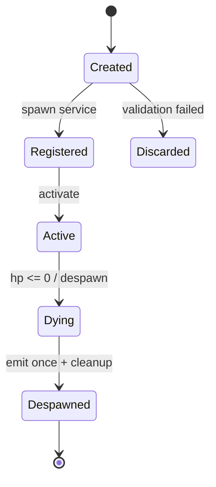
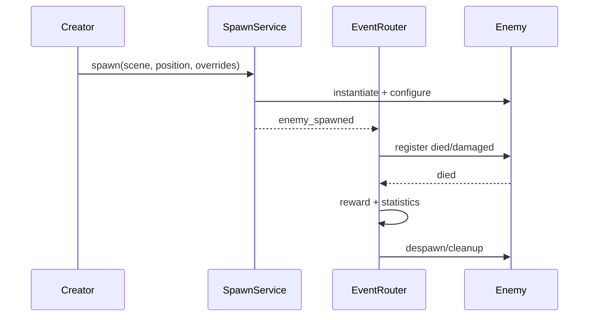

# 设计阶段最小图集

目标：用最少的图回答高风险问题，不为“画得像 UML”而画图。

> 图是设计检查工具，不是交付物本身。图必须能指向规则、代码位置、测试或决策记录；只画不落地不算完成。

## 1. 选择原则

1. **一张图只回答一个问题。** 不要把类型、状态、时序、部署塞进同一张图。
2. **先画动态风险，再补静态结构。** 新对象、事件、异步、池化、重试、清理优先。
3. **按风险选最小集。** 低风险不画全套；高风险不能只画类图。
4. **图与测试对应。** 每条关键路径至少对应一个验收项或测试。
5. **图要能过时。** 设计变化时更新图或标注失效，不保留“看起来完整”的旧图。

## 2. 图类型与边界

| 图 | 回答什么问题 | 什么时候必须 | 不能证明什么 |
|---|---|---|---|
| 上下文/组件图 | 边界、所有权、依赖方向、共享内核 | 新模块、新上下文、依赖方向变化 | 不能证明运行时创建/注册/清理 |
| 生命周期状态图 | 对象有哪些状态、允许哪些转换、结束条件 | 新增有状态对象、异步、池化、重试、持久化 | 不能展示具体调用顺序 |
| 时序图 | 一次流程的参与者、调用、事件顺序、失败路径 | 多条创建路径、跨上下文事件、注册/奖励/清理 | 不能展示类型结构 |
| 所有权/生命周期表 | 谁创建、谁注册、谁结束、谁清理、作用域 | 所有动态对象 | 不能替代状态转换图 |
| 事件/信号表 | 谁发出、谁监听、顺序、是否幂等 | 跨上下文事件、广播、奖励/统计 | 不能展示类型依赖 |
| 类图/接口图 | 类型、接口、继承、静态依赖 | 新抽象、新接口、多态扩展 | 不能证明生命周期接线 |

### 2.1 类图的局限

类图只能说明“是什么”和“静态依赖谁”，不能说明：

- 对象在哪条路径被创建；
- 创建后有没有注册；
- 死亡信号谁接；
- 奖励由谁发；
- 重开时谁清理。

所以：**类图可以定类型边界，不能单独证明生命周期正确。**

### 2.2 上下文地图的局限

上下文地图说明“谁负责什么”，但通常会漏掉同一上下文内部的动态创建：

- 某个实体在上下文内部生成另一个实体；
- 新实体会不会经过统一创建入口；
- 新实体会不会接入运行级事件。

上下文地图必须补“生命周期所有权”和“跨上下文事件”两节，否则只能定边界，不能防绕过。

## 3. 风险分级最小集

| 风险 | 判定 | 最小图集 |
|---|---|---|
| 低 | 新类型、无动态创建、无跨上下文事件 | 类图/组件图 + 一句生命周期说明 |
| 中 | 新增对象、单条创建路径、简单结束 | 上下文/组件图 + 主路径时序图 + 所有权表 |
| 高 | 多创建路径、动态生成、事件奖励、池化、异步、持久化、重开清理 | 上下文/组件图 + 生命周期状态图 + 每条创建路径时序图 + 所有权/生命周期表 + 事件表 |

高风险触发词：

- 分裂、召唤、动态生成、批量创建；
- 事件、信号、回调、异步、延迟；
- 池化、复用、热重载；
- 存档、回放、固定种子、重开；
- 经验、掉落、奖励、统计；
- 死亡、回收、超时、切场景、清理。

## 4. 必须画的情况

出现以下任一情况，设计阶段必须先有图或等价文字，再进入实现：

1. 新增有生命周期的对象，且对象不止“创建后一直存在”。
2. 同一对象有多条创建路径：正常生成、分裂、召唤、事件、测试、试玩。
3. 对象创建后需要注册到别的上下文，或需要发事件给别的上下文。
4. 对象有死亡、回收、超时、重开、切场景中的任意一种结束方式。
5. 对象带奖励、掉落、统计、持久化或回放。
6. 对象会被池化、复用或热重载。

## 5. 画法

### 5.1 上下文/所有权图

至少标出：

- 上下文/模块；
- 谁拥有容器、注册表、事件路由；
- 创建入口；
- 作用域（run / session / global）；
- 允许和禁止的依赖方向。

示例（游戏）：

```text
Run / Encounter
  └─ EnemySpawnService（唯一创建入口，run scope）
       ├─ creates Enemy
       └─ emits enemy_spawned
Run / EventRouter
  └─ listens enemy_spawned
       ├─ registers died/damaged
       └─ owns XP/drop/statistics
Enemies
  └─ owns AI/attributes/signals
       └─ must not instantiate enemy scenes directly
```

### 5.2 生命周期状态图

每个动态对象至少写：

- 初始状态；
- 注册状态；
- 活跃状态；
- 结束/死亡状态；
- 清理状态；
- 异常路径（创建失败、未注册、重复死亡）。



检查问题：

- 有没有“创建了但没注册”的合法状态？通常不应该有。
- 重复死亡会不会发两次奖励？
- 回收/超时和死亡是不是同一种结束语义？
- 暂停/重开时处于哪个状态？

### 5.3 时序图

每条创建路径各画一张，至少包含：

- 创建者；
- 创建入口；
- 注册/事件；
- 奖励/统计；
- 结束/清理；
- 失败路径。



如果图上出现“创建 → 直接结束”，中间没有注册/事件，就要明确这是有意隔离还是漏接线。

### 5.4 所有权/生命周期表

| 对象 | owner | 作用域 | 创建入口 | 注册方式 | 结束条件 | 清理方式 |
|---|---|---|---|---|---|---|
|  |  |  |  |  |  |  |

规则：

- 一个对象只有一个权威 owner。
- 创建入口和注册方式不能分叉。
- 结束条件要区分死亡、回收、超时、切场景。
- 清理方式要写清信号、计时器、池化、容器。

### 5.5 事件/信号表

| 事件/信号 | 发出者 | 监听者 | 顺序 | 幂等 | 失败处理 |
|---|---|---|---|---|---|
|  |  |  |  |  |  |

检查问题：

- 有没有只发不收的事件？
- 有没有重复注册？
- 监听者被销毁后还会不会收到事件？
- 事件在对象初始化前还是初始化后发？
- 事件是否改变 RNG/存档/回放？

## 6. 评审问题

提交设计前，逐项问：

1. 这个对象的生命周期有哪些状态？
2. 所有创建路径都走同一个入口吗？
3. 创建后谁负责注册？注册失败怎么办？
4. 死亡、回收、超时、重开分别走哪条路径？
5. 奖励/统计/UI 谁负责？会不会重复？
6. 哪张图能证明上述路径？对应哪个测试？
7. 如果新增第二种创建方式，哪张图会先坏？

## 7. 反模式

- 只画类图，不画状态和时序。
- 只画上下文地图，不写生命周期所有权。
- 只画正常路径，不画失败、回收、清理。
- 图画得很完整，但没有对应规则、验收或测试。
- 图过时但不标注，后来者按旧图实现。
- 为所有对象画全套 UML，导致没人维护。
- 把“图画完”当“设计完成”，不落地代码约束和测试。
