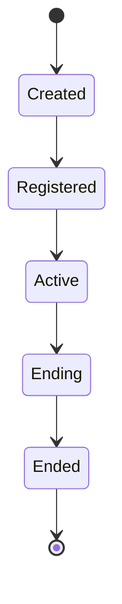
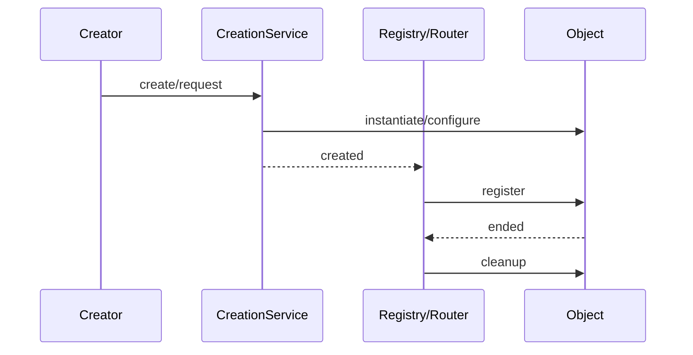
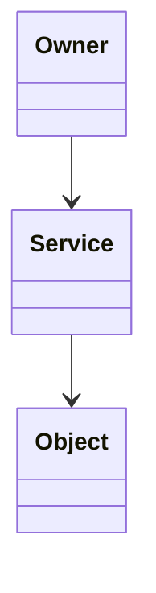

# 设计图模板

> 按风险选填，不要求全部画完；高风险生命周期变更必须填 1~5，类图按需填 6。

## 0. 设计问题

- 功能/模块：
- 设计问题：
- 风险级别：Low / Medium / High
- 明确不做：
- 对应规则/验收/ADR：

## 1. 上下文与所有权

| 上下文/模块 | 拥有 | 不拥有 | 作用域 |
|---|---|---|---|
|  |  |  |  |

依赖方向：

```text
（填写允许的依赖方向）
```

禁止依赖：

- 

## 2. 生命周期状态



| 状态 | 进入条件 | 允许的转换 | 退出/清理 |
|---|---|---|---|
|  |  |  |  |

异常路径：

- 创建失败：
- 未注册：
- 重复结束：
- 暂停/重载：

## 3. 关键时序

> 每条创建路径一张；没有时序图的路径必须用等价文字写清。

### 3.1 路径 A



失败/清理路径：

- 

### 3.2 路径 B

（同上）

## 4. 所有权与生命周期表

| 对象 | owner | 作用域 | 创建入口 | 注册方式 | 结束条件 | 清理方式 |
|---|---|---|---|---|---|---|
|  |  |  |  |  |  |  |

## 5. 事件/信号表

| 事件/信号 | 发出者 | 监听者 | 顺序 | 幂等 | 失败处理 |
|---|---|---|---|---|---|
|  |  |  |  |  |  |

## 6. 类型/接口（可选）



| 类型 | 职责 | 不负责 | 依赖 |
|---|---|---|---|
|  |  |  |  |

## 7. 图与验证对应

| 图/路径 | 对应规则/验收 | 对应测试 |
|---|---|---|
|  |  |  |

## 8. 未决问题

| 问题 | 影响 | owner | 何时定 |
|---|---|---|---|
|  |  |  |  |

## 9. 评审检查

- [ ] 所有创建路径都已列出
- [ ] 每条路径都有注册/结束/清理
- [ ] 副作用/统计/表现层有唯一 owner
- [ ] 失败、回收、超时、重载路径已画
- [ ] 图能指向规则/验收/测试
- [ ] 类图没有被当成生命周期证明
